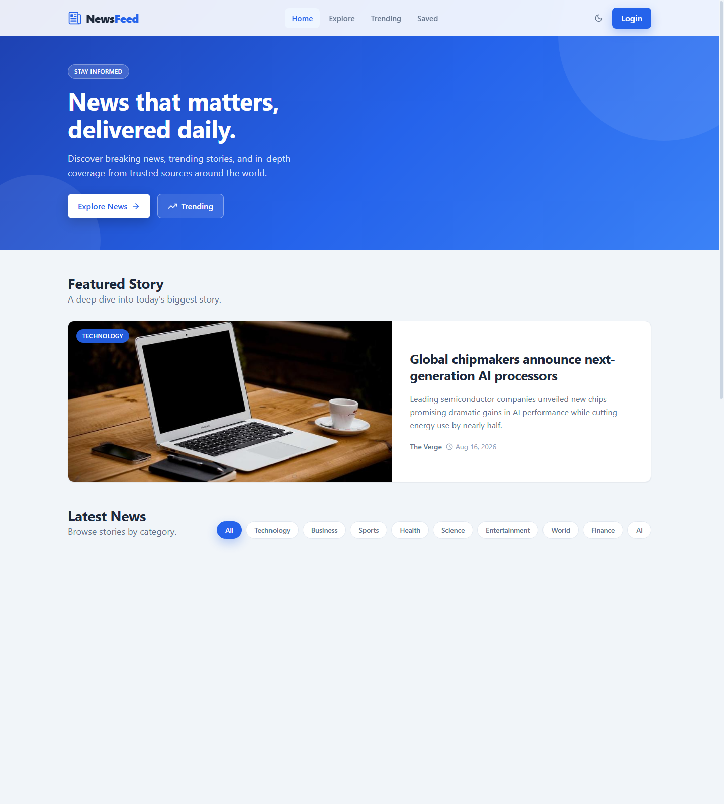
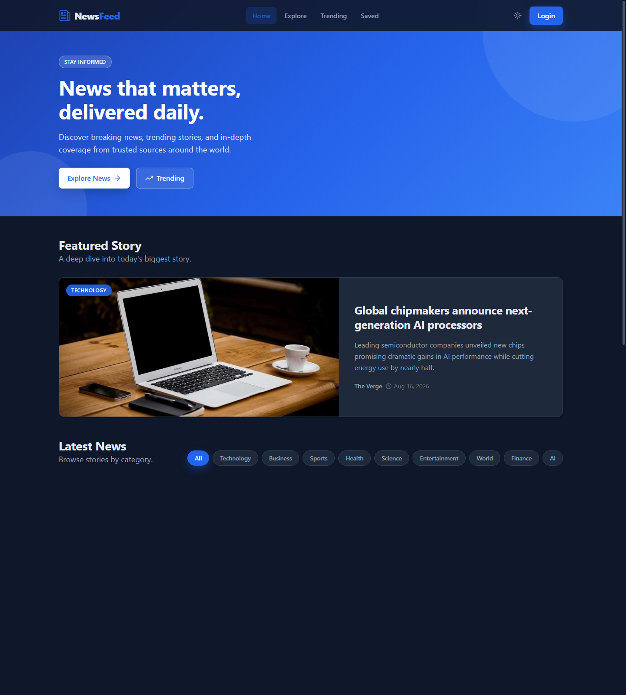
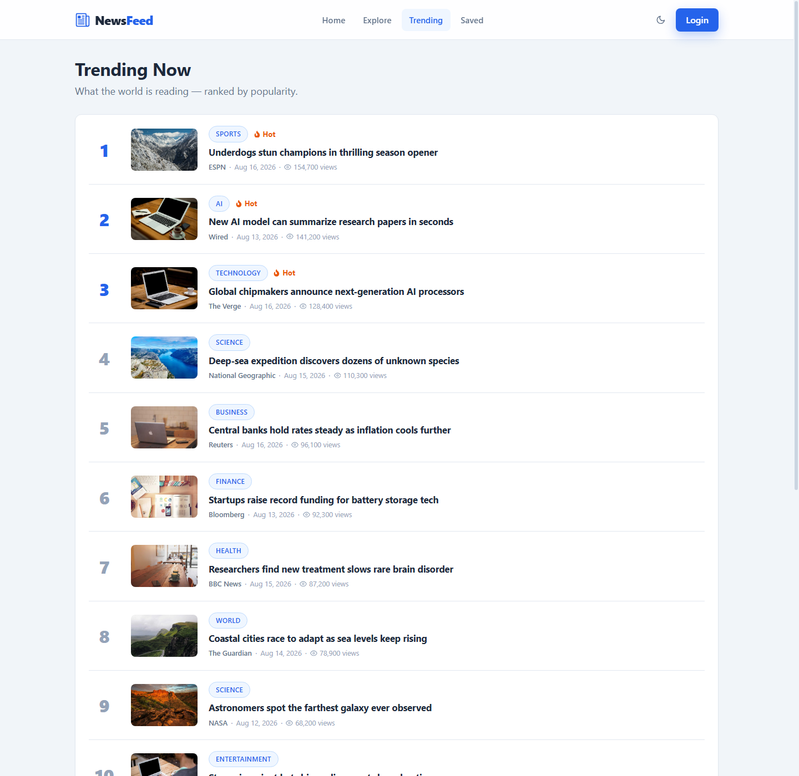
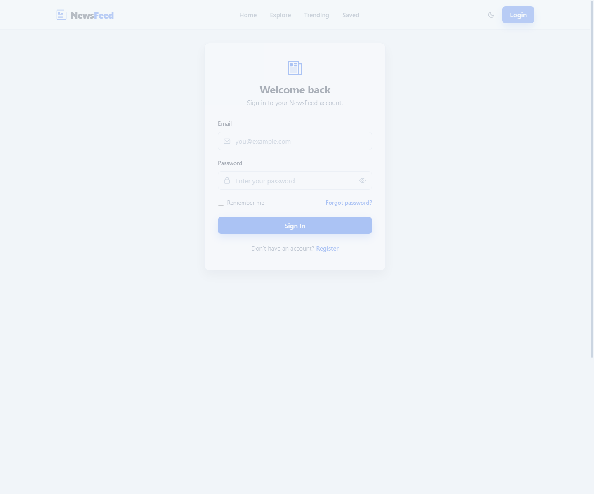

<div align="center">

# 📰 NewsFeed

**A modern news aggregation platform — discover, explore, and save the stories that matter.**

Built with **React** + **Spring Boot**, featuring **JWT authentication**, **dark mode**, and a fully responsive blue-and-white UI.

[](https://react.dev)
[](https://vite.dev)
[](https://spring.io/projects/spring-boot)
[](https://www.mysql.com)
[](https://jwt.io)
[](LICENSE)

</div>

---

## 📑 Table of Contents

- [Overview](#-overview)
- [Features](#-features)
- [Screenshots](#-screenshots)
- [Tech Stack](#-tech-stack)
- [Getting Started](#-getting-started)
- [Usage Guide](#-usage-guide)
- [REST API Reference](#-rest-api-reference)
- [Database Schema](#-database-schema)
- [Architecture & Key Concepts](#-architecture--key-concepts)
- [Project Structure](#-project-structure)
- [Scripts](#-scripts)
- [Testing & Quality](#-testing--quality)
- [Troubleshooting](#-troubleshooting)
- [Roadmap](#-roadmap)
- [License](#-license)

---

## 📖 Overview

NewsFeed is a **full-stack news aggregation platform** where users can:

- browse the latest headlines on a polished, magazine-style landing page
- **explore** articles by category or search across titles, descriptions, and sources
- see what's **trending** in a ranked list based on publisher coverage
- **save (bookmark)** articles and revisit them on a dedicated Saved page
- **register, log in, and recover passwords** through a complete authentication UI

The feed is **real news, not sample content**: the app reads public RSS feeds from
established publishers (BBC News, The Guardian, NPR, The New York Times, CNBC, ESPN,
Al Jazeera, TechCrunch, Ars Technica, ScienceDaily, Variety) and caches the result.
Headlines refresh **automatically every hour**, every card links to the original story,
and no news API key is required.

The **Spring Boot backend is written and ready** — once Maven and MySQL are installed,
the same UI plugs into the REST API for real persistence and JWT authentication.

> **Project goals:** a production-quality structure you can show in interviews and on
> LinkedIn — clean folder organization, reusable components, shared state via Context,
> protected routes, dark mode, responsive design, and a documented REST API.

---

## ✨ Features

### 🏠 Home — *landing experience*
- **Hero banner** — blue gradient with decorative depth, headline, and call-to-action buttons
- **Featured Story** — a large horizontal card promoting the newest live headline
- **Latest News grid** with **category filter chips** (World, Technology, AI, Business, …)
- **Live status strip** — shows the last update time and how many feeds responded, with a manual refresh
- **Skeleton loading** — shimmer placeholders while the first fetch is in flight

### 🔍 Explore — *discovery*
- **Live search** — filters today's real headlines as you type across title, description, category, and source
- **Category chips** — combine with search (`AI` category + `model` query)
- **Empty state** — a friendly dashed panel when nothing matches

### 🔥 Trending — *coverage*
- Stories ranked by **how many publishers are covering them**, then by freshness
- Big rank numbers, **top 3 highlighted** with a 🔥 "Hot" badge
- "N outlets" shown when several publishers run the same story
- Staggered slide-in animation per row

### 🔖 Saved — *bookmarks*
- Save any article with the bookmark icon on its card
- Bookmark state is **shared app-wide** via React Context — save from Home, see it in Saved
- Saved cards keep their snapshot, so a bookmark stays readable after it rotates out of the hourly feed
- **Protected route** — guests are redirected to Login, then returned after signing in
- Friendly empty state with a link to Explore

### 🔐 Authentication UI
- **Login** — email + password with validation, show/hide password, "remember me", forgot-password link
- **Register** — name/email/password/confirm with full validation (email format, min length, match check)
- **Forgot Password** — email form → success confirmation screen
- **Error banners** and **loading spinners** on submit
- Mock auth persists the user in localStorage (swaps to real JWT when the backend runs)

### 🌙 Dark Mode
- One-click 🌙/☀️ toggle in the navbar, animated
- Choice **persists** in localStorage; applied before React mounts (no flash)
- Implemented purely with **CSS variables** — one `[data-theme='dark']` block re-themes the whole app

### 🎨 Polish
- **Real sources** — every card carries the publisher name and links to the original story
- **Framer Motion** — staggered card cascades, page fades, button taps
- **Image fallbacks** — every image auto-falls back to a branded placeholder (never a broken icon)
- **3D depth** — layered shadows, hover lifts, image zoom on cards
- **Fully responsive** — 3 → 2 → 1 column grids, hamburger menu, mobile-tuned auth cards
- **Footer** with quick links and categories; scroll-to-top on navigation

---

## 📸 Screenshots

| Home — Light | Home — Dark |
|---|---|
|  |  |

| Explore | Trending | Login |
|---|---|---|
|  |  |  |

---

## 🧱 Tech Stack

**Frontend**

| Technology | Purpose |
|---|---|
| [React 19](https://react.dev) | UI components, hooks, and Context API |
| [Vite 8](https://vite.dev) | Build tool & dev server (HMR) |
| [React Router 7](https://reactrouter.com) | Client-side routing, protected routes |
| [Framer Motion](https://www.framer.com/motion/) | Animations & page transitions |
| [React Icons](https://react-icons.github.io/react-icons/) | Icon library (Feather, Ionicons, Font Awesome) |
| [Axios](https://axios-http.com) | HTTP client with JWT interceptor (backend-ready) |
| Public RSS feeds | Real headlines from BBC News, The Guardian, NPR, NYT, CNBC, ESPN, Al Jazeera, TechCrunch, Ars Technica, ScienceDaily, Variety |
| Node.js feed aggregator | Server-side fetch, parsing and hourly cache for `/api/news` |
| [Oxlint](https://oxc.rs/) | Fast linting (0 warnings on 31 files) |

**Backend** *(code complete — requires Maven + MySQL to run)*

| Technology | Purpose |
|---|---|
| Java 21 (LTS) | Language |
| [Spring Boot 3.3](https://spring.io/projects/spring-boot) | REST API framework |
| Spring Security + **JJWT** | Password hashing (BCrypt), JWT issuing & verification |
| Spring Data JPA / Hibernate | ORM, repositories, automatic schema |
| MySQL | Relational database |
| Maven | Build & dependency management |

**Tools used during development** — Node.js 22, headless Chrome (rendering verification).

---

## 🚀 Getting Started

### Prerequisites

| Tool | Version | Required for |
|---|---|---|
| Node.js | ≥ 20 | Frontend |
| npm | ≥ 9 | Frontend |
| Java | 21 (LTS) | Backend |
| Maven | 3.9+ | Backend |
| MySQL | 8.x | Backend |

### 1. Run the frontend

```bash
# install dependencies
npm install

# start the dev server (http://localhost:5173)
npm run dev
```

The app runs with **live news out of the box** — no backend and no API key needed.
`npm run dev` also starts the small feed aggregator that serves `/api/news`, so every
page has real headlines immediately. An internet connection is required to reach the
publishers; if a feed is down it is skipped, and if the network is unavailable the last
cached snapshot is served instead.

Register/login/save still run on the mock auth layer until the Spring Boot backend is wired in.

### 2. Run the backend *(optional)*

The complete Spring Boot API lives in [`backend/`](backend/README.md). Summary:

```bash
# 1. Edit backend/src/main/resources/application.yml
#    → set your MySQL username/password and a strong JWT secret

# 2. Start the API (creates the 'newsfeed' database + seeds 12 articles)
cd backend
mvn spring-boot:run
```

The API starts at **http://localhost:8080/api**. Full endpoint docs: see the
[REST API Reference](#-rest-api-reference) below or [`backend/README.md`](backend/README.md).

### Environment variables (frontend)

| Variable | Default | Description |
|---|---|---|
| `VITE_API_URL` | `http://localhost:8080/api` | Base URL of the Spring Boot API (used by `src/services/api.js`) |

No environment variables are needed for the live news feed — it uses public RSS and a
same-origin `/api/news` route provided by the Vite dev/preview server locally and by a
Vercel function in production.

### 3. Deploy on Vercel

The repo is Vercel-ready: [`api/news.js`](api/news.js) serves `/api/news` as a
serverless function using the same aggregator as local dev, and `vercel.json` builds
the SPA into `dist/` while keeping client-side routes working. No environment
variables or API keys are required.

**From the dashboard (recommended):**

1. Push the repository to GitHub.
2. In Vercel choose **Add New → Project** and import the repository. The Vite
   framework, build command and output directory come from `vercel.json`.
3. Click **Deploy**. Every later push to `main` redeploys automatically.

**From the CLI:**

```bash
npx vercel link
npx vercel --prod
```

The first request after a cold start fetches the publishers, so it takes a few seconds;
serverless instances keep the snapshot in memory (and in `/tmp`) between requests, so
subsequent loads are immediate.

---

## 🧭 Usage Guide

1. **Browse** — the Home page shows the hero, the newest headline, and today's news.
2. **Filter** — click category chips (Home or Explore) to narrow the feed.
3. **Search** — go to **Explore** and type in the search bar (e.g. `AI` or `election`).
4. **Check trends** — open **Trending** to see stories ranked by publisher coverage.
5. **Read the source** — click any card to open the full story on the publisher's site.
6. **Refresh now** — the live strip on Home/Explore/Trending shows the last update time;
   the ↻ button forces a check (limited to once every 5 minutes), otherwise it updates hourly.
7. **Create an account** — go to **Login → Register** (any email, password ≥ 6 chars).
8. **Save articles** — click the 🔖 bookmark on any card (logged in or not).
9. **View saved** — open **Saved** (requires login) to see your bookmarks.
10. **Log out** — click the logout icon in the navbar; try opening **Saved** again to see the redirect.
11. **Dark mode** — toggle the 🌙/☀️ icon in the navbar at any time.

> **Demo tip:** register → bookmark 3–4 articles → log out → try `/saved` → log back in —
> you'll land back on your Saved page.

---

## 📡 REST API Reference

### Live news endpoint (this repo)

`GET /api/news` — served by the Vite dev/preview server from `server/news.js`.
The browser never talks to a publisher directly (no CORS problems, no keys in the bundle).

```json
{
  "articles": [
    {
      "id": "e721bf5c712d",
      "title": "…",
      "description": "…",
      "image": "https://…",
      "category": "Technology",
      "source": "TechCrunch",
      "publishedAt": "2026-11-10T07:06:01.000Z",
      "url": "https://techcrunch.com/…",
      "coverage": 2
    }
  ],
  "categories": ["All", "World", "Technology", "AI", "…"],
  "sources": [{ "name": "BBC News", "category": "World", "ok": true, "count": 33 }],
  "updatedAt": "2026-11-10T07:15:42.380Z",
  "stale": false
}
```

- **Cache:** one hour in memory, mirrored to `.cache/news.json` so a restart can serve the last snapshot.
- **`?refresh=1`:** asks for a new fetch; ignored if the snapshot is under 5 minutes old.
- **Failure handling:** dead feeds are skipped and reported in `sources`; if every feed fails, the last good snapshot is returned with `stale: true`.
- **Coverage:** how many distinct publishers are running the same story (headline clustering).

### Spring Boot API

Base URL: `http://localhost:8080/api` — all endpoints return JSON.

| Method | Endpoint | Auth | Description |
|---|---|---|---|
| POST | `/auth/register` | Public | Create an account, returns JWT |
| POST | `/auth/login` | Public | Log in, returns JWT |
| GET | `/articles` | Public | All articles (newest first) |
| GET | `/articles?category=AI` | Public | Filter by category |
| GET | `/articles?q=galaxy` | Public | Search title/description/source |
| GET | `/articles/trending` | Public | Top 10 by views |
| GET | `/articles/{id}` | Public | Single article |
| GET | `/categories` | Public | Distinct categories |
| GET | `/saved` | 🔒 JWT | The user's saved articles |
| POST | `/saved/{articleId}` | 🔒 JWT | Save an article |
| DELETE | `/saved/{articleId}` | 🔒 JWT | Unsave an article |

### Example — Register

```bash
curl -X POST http://localhost:8080/api/auth/register \
  -H "Content-Type: application/json" \
  -d '{"name":"John","email":"john@example.com","password":"secret123"}'
```

```json
// 201 Created
{ "token": "eyJhbGciOiJIUzI1NiJ9...", "name": "John", "email": "john@example.com" }
```

### Example — Login

```bash
curl -X POST http://localhost:8080/api/auth/login \
  -H "Content-Type: application/json" \
  -d '{"email":"john@example.com","password":"secret123"}'
```

### Example — Protected call (saved articles)

```bash
curl http://localhost:8080/api/saved \
  -H "Authorization: Bearer <your-jwt-token>"
```

### Error format

```json
{ "status": 400, "message": "Email is already registered" }
```

| Status | Meaning |
|---|---|
| `400` | Validation failed or business rule violated |
| `401` | Missing/invalid token or wrong credentials |
| `404` | Resource not found |
| `500` | Unexpected server error |

---

## 🗄️ Database Schema

**Database name:** `newsfeed`

- **Host:** `localhost:3306` (configured in `backend/src/main/resources/application.yml`)
- Created **automatically** on first run (`createDatabaseIfNotExist=true`)
- Three tables, created by Hibernate (`ddl-auto: update`):

**`users`**
| Column | Type | Notes |
|---|---|---|
| `id` | BIGINT | Primary key, auto-increment |
| `name` | VARCHAR | Full name |
| `email` | VARCHAR | **Unique** — used as the login identifier |
| `password` | VARCHAR | BCrypt hash (plain passwords are never stored) |
| `created_at` | DATETIME | Set automatically |

**`articles`**
| Column | Type | Notes |
|---|---|---|
| `id` | BIGINT | Primary key |
| `title` | VARCHAR(500) | Headline |
| `description` | TEXT | Summary |
| `image_url` | VARCHAR | Cover image (picsum.photos in seed data) |
| `category` | VARCHAR | Technology, Business, Sports, … |
| `source` | VARCHAR | e.g. The Verge, Reuters |
| `published_at` | DATETIME | Publish date |
| `views` | BIGINT | Used by the Trending ranking |

**`saved_articles`** (join table)
| Column | Type | Notes |
|---|---|---|
| `id` | BIGINT | Primary key |
| `user_id` | BIGINT | FK → `users.id` |
| `article_id` | BIGINT | FK → `articles.id` |
| `saved_at` | DATETIME | Set automatically |

> `saved_articles` has a **unique constraint on (user_id, article_id)** so a user can
> save an article only once — saving twice is a no-op (idempotent).

---

## 🏗️ Architecture & Key Concepts

### Frontend

- **Component hierarchy** — `pages` (screens) compose `components` (reusable UI). The
  Navbar and Footer render on every route via `App.jsx`.
- **React Context** — four contexts provide app-wide state:
  - `ThemeContext` → light/dark mode (localStorage-persisted)
  - `AuthContext` → current user, login/register/logout (mock now, JWT-ready)
  - `NewsContext` → live articles, categories, update time; polls `/api/news` hourly (and when a hidden tab becomes visible)
  - `SavedNewsContext` → bookmarked article snapshots shared across all pages
- **Protected routes** — `RequireAuth` wraps `/saved`; guests are redirected to `/login`
  with their intended destination in `location.state`, then returned after login.
- **Theming with CSS variables** — every color is a token in `src/index.css`;
  `[data-theme='dark']` overrides the tokens, so components need no dark-mode code.
- **Animations** — Framer Motion *variants* let the grid stagger child cards; pages fade in.
- **Image resilience** — `SmartImage` swaps to a local branded fallback on error/missing src.

### Live news pipeline

- `server/feeds.js` lists the 17 public RSS feeds (11 publishers) and their categories.
- `server/news.js` fetches every feed in parallel with a 10s timeout, parses the RSS,
  strips HTML, decodes entities, extracts a lead image, normalises timestamps and builds
  stable IDs from the article URL (so bookmarks survive refreshes).
- Headlines from the last 48 hours are preferred; if that window is thin it widens to 7 days.
  Duplicate links are dropped, near-identical headlines are clustered to compute `coverage`,
  and the newest 120 articles are returned.
- `server/apiPlugin.js` exposes the cache as `GET /api/news` inside Vite's dev and preview
  servers, so the frontend uses one origin and there is no CORS or API key to manage.
- The client never fabricates content: if the endpoint fails, pages show an explicit error
  with a retry instead of falling back to sample articles.

### Backend

- **Layered architecture** — `Controller → Service → Repository` with DTOs at the boundary
  (entities are never exposed directly).
- **JWT flow** — register/login returns a signed token → the frontend sends it as
  `Authorization: Bearer <token>` → `JwtAuthFilter` validates it and sets the security
  context → `SecurityConfig` permits public endpoints and requires auth on `/saved/**`.
- **Passwords** — hashed with **BCrypt** before storage.
- **CORS** — `CorsConfig` allows the React dev server origin (`http://localhost:5173`).
- **Seed data** — `data.sql` inserts 12 sample articles so the Spring API has something to return before it is connected to the live feed
  (`INSERT IGNORE` makes it safe to re-run).

---

## 📁 Project Structure

```
├── src/
│   ├── components/
│   │   ├── auth/          → AuthCard (shared auth shell), RequireAuth (protected route)
│   │   ├── common/        → SmartImage (fallback images), CategoryChips, PagePlaceholder
│   │   ├── layout/        → Navbar (theme toggle + user menu), Footer, ScrollToTop
│   │   └── news/          → NewsCard, NewsGrid, SkeletonCard (loading shimmer)
│   ├── context/           → ThemeContext, AuthContext, NewsContext, SavedNewsContext
│   ├── pages/             → Home, Explore, Trending, Saved, Login, Register, ForgotPassword
│   ├── services/          → api.js (axios client with JWT interceptor)
│   ├── utils/             → format.js (dates, relative time, clock time)
│   ├── App.jsx            → route definitions
│   └── main.jsx           → providers + entry point
├── server/
│   ├── feeds.js           → publisher RSS feeds + category order
│   ├── news.js            → fetch, parse, dedupe, cluster, hourly cache
│   └── apiPlugin.js       → GET /api/news middleware for Vite dev & preview
├── .cache/news.json       → last good snapshot (gitignored, auto-created)
├── backend/
│   ├── src/main/java/com/newsfeed/
│   │   ├── config/        → SecurityConfig, CorsConfig
│   │   ├── controller/    → Auth, Article, Categories, SavedArticle
│   │   ├── dto/           → request/response records
│   │   ├── entity/        → User, Article, SavedArticle
│   │   ├── exception/     → ApiException, ResourceNotFoundException, GlobalExceptionHandler
│   │   ├── repository/    → Spring Data JPA interfaces
│   │   ├── security/      → JwtService, JwtAuthFilter, CustomUserDetailsService
│   │   └── service/       → AuthService, ArticleService, SavedArticleService
│   └── src/main/resources/ → application.yml, data.sql
├── screenshots/           → README screenshots
├── public/                → static assets (favicon)
├── index.html             → HTML shell (applies saved theme before React loads)
└── package.json           → frontend scripts & dependencies
```

---

## 🛠️ Scripts

| Command | What it does |
|---|---|
| `npm run dev` | Start the Vite dev server (hot reload) |
| `npm run build` | Production build → `dist/` |
| `npm run preview` | Preview the production build locally |
| `npm run lint` | Lint all source files (Oxlint) |
| `mvn spring-boot:run` *(backend)* | Start the Spring Boot API |

---

## 🧪 Testing & Quality

- **Lint** — `npm run lint` → **0 warnings, 0 errors** (Oxlint, 92 rules)
- **Live feed** — `/api/news` verified against all 17 feeds: 120 articles returned, every
  item has a title, publisher, timestamp and working source URL
- **Build** — `npm run build` → production bundle compiles cleanly
- **Rendering verification** — every page was smoke-tested at desktop (1440px) and mobile
  (375px) widths with headless Chrome during development; protected-route redirects were
  confirmed in the rendered DOM

> Automated unit tests (Jest/Vitest for the frontend, JUnit for the backend) are a
> planned addition — see [Roadmap](#-roadmap).

---

## 🛠️ Troubleshooting

| Problem | Likely cause & fix |
|---|---|
| **Blank screen** | Check the browser console. Verify imports/paths, default vs named exports, and that routes are inside `<BrowserRouter>` |
| **"Port 5173 already in use"** | Another dev server is running → stop it or run `npm run dev -- --port 5174` |
| **Images not loading** | Publisher images need internet; the app falls back to a local branded placeholder automatically |
| **"Live news is unavailable"** | No internet, a firewall blocking the publishers, or every feed erroring at once. Check `http://localhost:5173/api/news`; the page retries hourly, and the last good snapshot in `.cache/news.json` is used when available |
| **Headlines look old** | The endpoint caches for one hour. Press the ↻ button in the live strip (max once per 5 minutes) or delete `.cache/news.json` and restart |
| **CORS errors when calling the API** | Confirm the backend is running on `:8080` and the frontend origin is `http://localhost:5173` (allowed in `CorsConfig`) |
| **Backend can't connect to MySQL** | Verify MySQL is running and `application.yml` credentials match your install |
| **Dark mode not saving** | localStorage disabled → theme still toggles, just won't persist |

---

## 🗺️ Roadmap

- [x] Frontend UI (all pages, auth flow, dark mode, animations)
- [x] Live news feed (real publishers, hourly refresh, source links)
- [x] Backend code (Spring Boot, JWT, MySQL, REST API)
- [ ] Install Maven + MySQL and run the backend
- [ ] Frontend ↔ Spring Boot integration (axios calls replace the mock auth layer)
- [ ] Persist saved articles per user (currently an in-memory snapshot)
- [ ] Automated tests (Vitest + JUnit)
- [ ] Article detail page
- [ ] Pagination / infinite scroll
- [ ] Deployment (Vercel / Netlify frontend, Render / Railway backend)

---

## 📄 License

MIT — free to use for portfolios, college projects, and learning.
